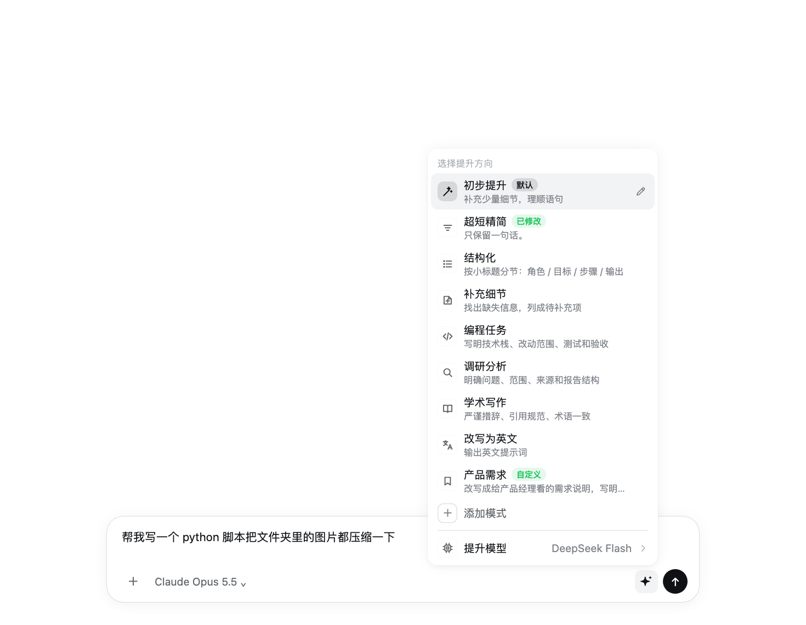
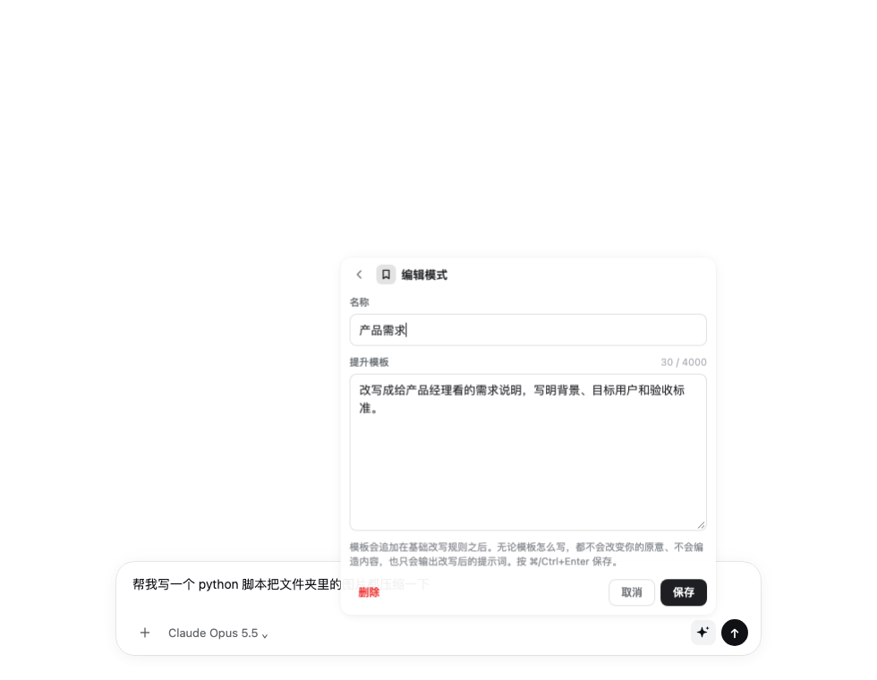
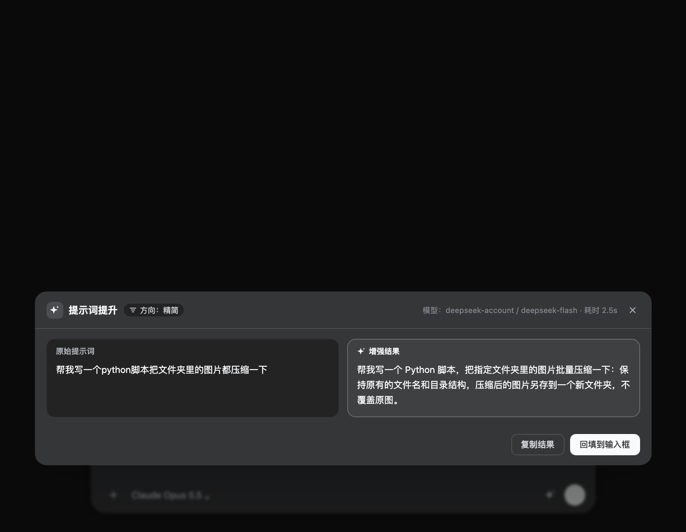

# dsh-prompt-booster

A prompt booster for the [DeepSeek Harness](https://github.com/deepseek-ai/deepseek-harness) (dsh) web GUI. A small button next to the composer: **left-click** polishes the draft and puts it straight back, **right-click** picks a boost mode, edits a mode's template, or chooses which model does the rewrite.

English | [简体中文](./README.zh-CN.md)




## Features

- **Left-click: quick boost, applied in place.** No popup: the button spins, the result replaces the composer text, and an **Undo** chip appears above the composer. The quick boost is a light touch: it smooths the wording and adds a few details the draft or conversation clearly implies, stays within about 1.5x the original length, and adds no role line, headings, steps or acceptance criteria. Click again while it runs to cancel; if you edit the draft while waiting, the result opens in the preview instead of overwriting your edits.
- **Right-click: pick a boost mode.** Eight built-in modes: quick boost, concise, structured, fill in details, coding task, research, academic writing, rewrite in English. Every mode except the quick boost shows an original / result preview first, then you apply, copy or cancel. A long press (touch) or the keyboard context-menu key also opens the menu.
- **Edit mode templates, add modes.** The ✎ next to each mode (or → on a focused row) edits its name and template; **＋ Add a mode** at the end creates a new one. Edited built-ins can be restored to default; created modes can be deleted. Modes are saved on the dsh host, so every browser and the `/boost` command share them.
- **Choose the boost model.** **Boost model** at the bottom of the menu lists the models dsh can currently route to (the same live list as dsh's own model picker). It only affects boosting, never the chat model. The default, **Follow default**, uses the plugin settings pair → the current session's model → the dsh default model.
- **Slash command.** `/boost [@mode] text`, e.g. `/boost @coding fix the login page error`. The result shows in the command plane and never enters the conversation history.
- **Follows the dsh theme.** Colors, radii and shadows come from dsh's own design tokens, so light/dark follows dsh's appearance setting.

| Mode editor | Preview panel (dark) |
|---|---|
|  |  |

## Install

Requires dsh `>= 0.1.1-rc.2 < 0.3.0` (tested on 0.2.1-rc.3).

From GitHub (the built `lib/` is committed, so nothing is compiled on your machine):

```bash
dsh plugin --profile web add github:HanYu-me/dsh-prompt-booster
# the desktop app's profile is called "desktop": dsh plugin --profile desktop add github:HanYu-me/dsh-prompt-booster
```

A prebuilt `dsh-prompt-booster.tgz` is also attached to each [release](https://github.com/HanYu-me/dsh-prompt-booster/releases). Restart dsh after installing.

> If `dsh-prompt-enhance` is installed too, disable one of them: both add a composer button and share the default shortcut (`Ctrl+Alt+E`).

Uninstall: `dsh plugin --profile web remove dsh-prompt-booster`, then restart dsh.

## Usage

| Action | Result |
|---|---|
| Left-click ✨ / `Ctrl+Alt+E` | Boost with the default mode (quick boost by default: applied in place, undoable) |
| Right-click ✨ | Open the mode menu |
| Click a mode in the menu | Boost with that mode |
| ✎ next to a mode, or → on a focused row | Edit its name and template (⌘/Ctrl+Enter saves, Esc goes back) |
| **＋ Add a mode** | Create a mode |
| **Boost model** | Choose the model used for boosting |

A mode's template is appended after the base rewrite rules. Whatever it says, the rewrite keeps your intent, invents nothing, and outputs only the rewritten prompt. Except for the quick boost, the base rules add structure (role, steps, acceptance criteria); to keep a mode short, say so in its template, e.g. "keep it brief, no steps or acceptance criteria".

## Settings

Edited on dsh's plugin configuration page (`prompt-boost`); changes apply to the next boost without a restart.

| Field | Default | Description |
|---|---|---|
| `enabled` | `true` | Master switch |
| `quickApply` | `true` | The quick boost replaces the draft directly; off = preview like the other modes |
| `defaultDirection` | `general` | Mode id used by left-click and the shortcut |
| `customDirections` | empty | Modes defined as text, one `id \| name \| instruction` per line (modes saved from the menu editor take precedence) |
| `provider` + `model` | empty | Fixed model route (fill both); a model picked in the menu wins over it |
| `temperature` | `0.3` | Sampling temperature |
| `maxOutputTokens` | `2048` | Output budget of one boost |
| `maxInputChars` | `12000` | Draft length cap; longer drafts are refused, never truncated |
| `timeoutMs` | `60000` | Deadline of one boost |
| `systemPrompt` / `strategyMode` | empty / `replace-default` | Custom base rewrite rules and how they combine with the built-in ones |
| `shortcut` | `ctrl+alt+e` | Keyboard shortcut; empty disables it |
| `streaming` | `true` | Stream the result into the preview panel |
| `contextAware` | `true` | Use the last few turns of the conversation to resolve references |
| `contextMaxMessages` / `contextMaxChars` | `8` / `4000` | How much conversation it may use |
| `maxConcurrent` / `rateLimitPerMinute` | `2` / `10` | Concurrency and per-minute caps |

## Data and privacy

- Every boost is one model call that sends the draft to the chosen model; with `contextAware` on it also sends the last few turns of the conversation. Turn `contextAware` off when the conversation holds anything sensitive.
- Modes saved from the editor live on the dsh machine in `~/.dsh/prompt-boost/directions.json` (override with `DSH_PROMPT_BOOST_DIRECTIONS_FILE`).
- The boost-model choice is stored in the browser (localStorage).
- The plugin's HTTP routes only accept loopback requests.

## Development

```bash
git clone https://github.com/HanYu-me/dsh-prompt-booster.git
cd dsh-prompt-booster
npm install
npm test          # unit, real-HTTP and component suites
npm run typecheck
npm run build     # lib/index.js (host half) + lib/client.js (browser half)
dsh plugin --profile web add link:$PWD
```

Browser-half changes need a rebuild and a page reload; host-half changes need a dsh restart. Commit `lib/` together with the source, because GitHub installs are not built on the user's machine.

## License

[Apache-2.0](./LICENSE) © Yu Han
