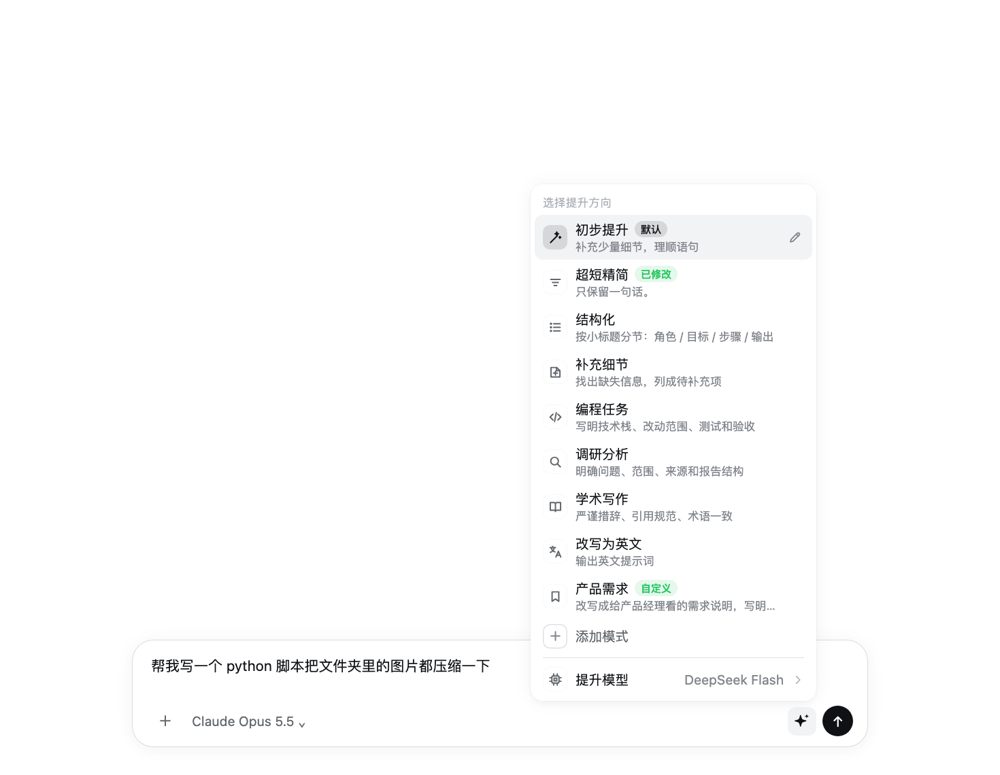
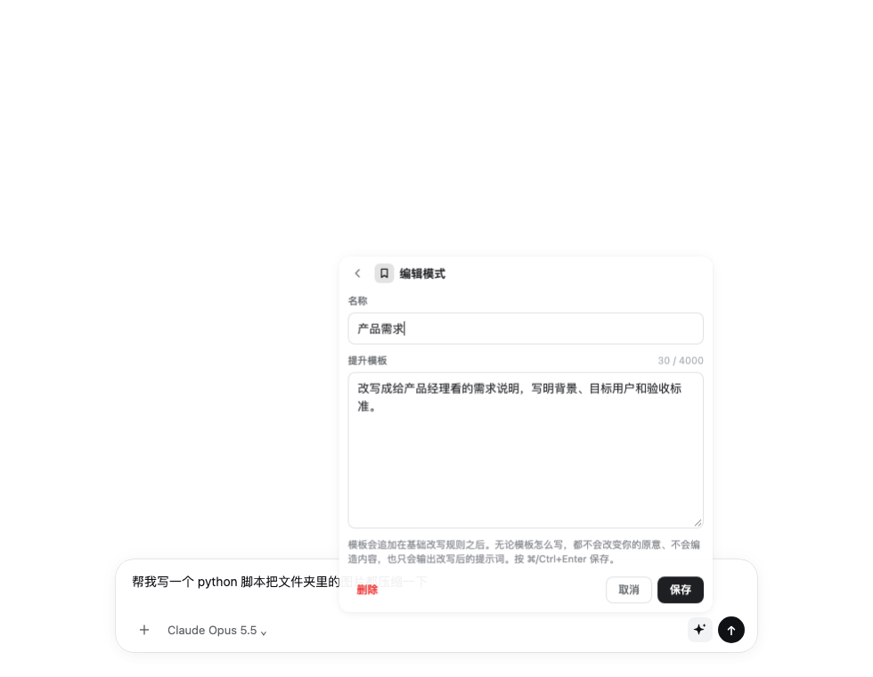
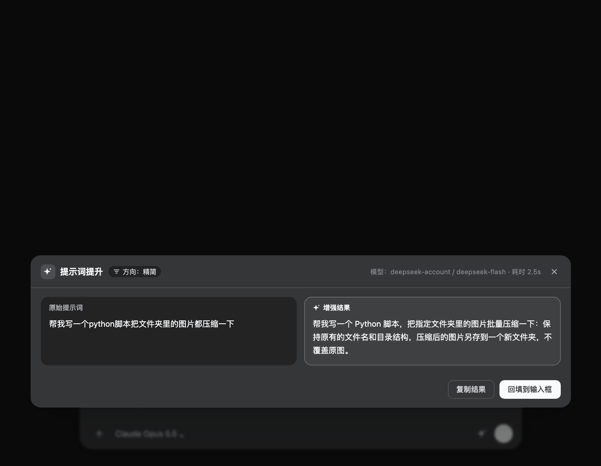

# dsh-prompt-booster

[DeepSeek Harness](https://github.com/deepseek-ai/deepseek-harness)（dsh）网页界面的提示词提升插件：输入框旁一个小按钮，**左键**直接把草稿润色好并替换回去，**右键**选择提升模式、编辑模式模板、选择用哪个模型来改写。

[English](./README.md) | 简体中文

> 本插件基于 [rongxingda](https://github.com/rongxingda) 的 [dsh-prompt-enhance](https://github.com/rongxingda/dsh-prompt-enhance) 0.3.2（Apache-2.0）修改而来。预览面板、撤销、草稿保护、限流和模型调用等基础能力来自原插件；在此之上新增了提升模式、模式编辑器、提升模型选择和直接替换的初步提升等功能，具体改动见 [CHANGELOG](./CHANGELOG.md) 和 [NOTICE](./NOTICE)。




## 功能

- **左键：初步提升，直接替换**——不弹窗。按钮转圈，结果回来后直接替换输入框内容，上方出现「撤销」。初步提升是轻量改写：只理顺语句、补充少量上下文中明显隐含的细节，长度约为原文 1.5 倍以内，不加角色、小标题、步骤、验收标准。等待时再点一次按钮可取消；等待期间改了草稿，则不覆盖，改为弹出预览。
- **右键：选择提升模式**——8 个内置模式：初步提升、精简、结构化、补充细节、编程任务、调研分析、学术写作、改写为英文。除初步提升外，其余模式先显示「原文 / 提升结果」对比，再决定回填、复制或取消。触屏长按、或聚焦按钮后按键盘菜单键也能打开。
- **编辑模式模板、添加模式**——每个模式右边的 ✎（或选中后按 →）可修改名称和提升模板；列表末尾「＋ 添加模式」新建模式。内置模式改过后可「恢复默认」，新建的模式可删除。模式保存在 dsh 后端，所有浏览器和 `/boost` 命令共用。
- **选择提升用的模型**——菜单底部「提升模型」列出 dsh 当前可用的模型（与 dsh 自带模型选择器同一份实时列表），只影响提示词提升，不改变对话模型。默认「跟随默认」：插件设置 → 当前会话模型 → dsh 默认模型。
- **斜杠命令**——`/boost [@模式] 文本`，例如 `/boost @coding 修一下登录页的报错`。结果显示在命令区，不进入对话历史。
- **界面跟随 dsh 主题**——颜色、圆角、阴影用 dsh 自己的设计变量，深色/浅色跟随 dsh 的外观设置。

| 模式编辑 | 预览面板（深色） |
|---|---|
|  |  |

## 安装

需要 dsh `>= 0.1.1-rc.2 < 0.3.0`（在 0.2.1-rc.3 上测试）。

从 GitHub 安装（仓库里已提交构建好的 `lib/`，安装时不需要编译）：

```bash
dsh plugin --profile web add github:HanYu-me/dsh-prompt-booster
# 桌面版的 profile 名是 desktop：dsh plugin --profile desktop add github:HanYu-me/dsh-prompt-booster
```

也可以从 [Releases](https://github.com/HanYu-me/dsh-prompt-booster/releases) 下载预构建的 `dsh-prompt-booster.tgz` 安装。装好后重启 dsh。

> 如果同时装了 `dsh-prompt-enhance`，请停用其中一个：两者都会在输入框加按钮，默认快捷键也相同（`Ctrl+Alt+E`）。

卸载：`dsh plugin --profile web remove dsh-prompt-booster`，然后重启 dsh。

## 使用

| 操作 | 效果 |
|---|---|
| 左键点击 ✨ / `Ctrl+Alt+E` | 用默认模式提升（默认「初步提升」：直接替换，可撤销） |
| 右键点击 ✨ | 打开模式菜单 |
| 菜单里点某个模式 | 用该模式提升 |
| 模式右侧 ✎，或选中后按 → | 编辑该模式的名称和模板（⌘/Ctrl+Enter 保存，Esc 返回） |
| 「＋ 添加模式」 | 新建模式 |
| 「提升模型」 | 选择提升使用的模型 |

模板会追加在基础改写规则之后。无论模板怎么写，改写都不会改变原意、不会编造内容、只输出改写后的提示词。除「初步提升」外，基础规则会补充角色、步骤、验收标准等结构；想让某个模式输出简短，就在模板里写明「保持简短，不要加步骤和验收标准」。

## 设置

在 dsh 的插件配置页（`prompt-boost`）修改，保存后下一次提升即生效，无需重启。

| 字段 | 默认值 | 说明 |
|---|---|---|
| `enabled` | `true` | 总开关 |
| `quickApply` | `true` | 初步提升直接替换输入框；关闭后和其他模式一样先预览 |
| `defaultDirection` | `general` | 左键和快捷键使用的模式 id |
| `customDirections` | 空 | 用文本定义的模式，每行 `id \| 名称 \| 指令`（菜单编辑器保存的模式优先级更高） |
| `provider` + `model` | 空 | 固定使用的模型（须成对填写）；菜单里选了模型时以菜单为准 |
| `temperature` | `0.3` | 采样温度 |
| `maxOutputTokens` | `2048` | 单次提升的输出上限 |
| `maxInputChars` | `12000` | 草稿字数上限，超出则拒绝（不会截断） |
| `timeoutMs` | `60000` | 单次提升超时 |
| `systemPrompt` / `strategyMode` | 空 / `replace-default` | 自定义基础改写规则，以及它与内置规则的组合方式 |
| `shortcut` | `ctrl+alt+e` | 快捷键，留空禁用 |
| `streaming` | `true` | 预览面板边生成边显示 |
| `contextAware` | `true` | 参考当前会话最近几轮对话来补全指代和背景 |
| `contextMaxMessages` / `contextMaxChars` | `8` / `4000` | 参考对话的条数和字数上限 |
| `maxConcurrent` / `rateLimitPerMinute` | `2` / `10` | 并发与每分钟次数上限 |

## 数据与隐私

- 每次提升都是一次模型调用，会把草稿发给所选模型；开启 `contextAware` 时还会附带最近几轮对话。对话里有敏感信息时，可以关掉 `contextAware`。
- 编辑器保存的模式存在 dsh 所在机器的 `~/.dsh/prompt-boost/directions.json`（可用环境变量 `DSH_PROMPT_BOOST_DIRECTIONS_FILE` 改路径）。
- 「提升模型」的选择存在浏览器本地（localStorage）。
- 插件的接口只接受本机（loopback）请求。

## 开发

```bash
git clone https://github.com/HanYu-me/dsh-prompt-booster.git
cd dsh-prompt-booster
npm install
npm test          # 单元、真实 HTTP 与组件测试
npm run typecheck
npm run build     # 生成 lib/index.js（后端）与 lib/client.js（前端）
dsh plugin --profile web add link:$PWD
```

前端改动重新构建后刷新页面即可；后端改动需要重启 dsh。`lib/` 需要随代码一起提交，因为从 GitHub 安装不会在用户那边构建。

## 许可

[Apache-2.0](./LICENSE)。

- 原作品：[dsh-prompt-enhance](https://github.com/rongxingda/dsh-prompt-enhance) © rongxingda，Apache-2.0。
- 修改部分 © 2026 Yu Han，同样以 Apache-2.0 发布。

署名与修改说明见 [NOTICE](./NOTICE)。感谢 rongxingda 的原始实现。
